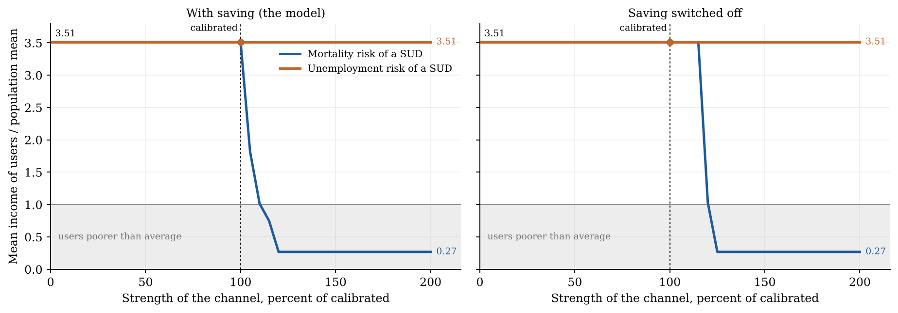

# Stylized model (Section 3) recalibrated under log utility (sigma = 1)

**Headline.** Under log, a full recalibration hits all five targets exactly, with **kappa = 11.95**,
against 3.56 at sigma = 2. That is 1.8 to 3.1 times the literature range the paper cites, 3.91 (Plana-Ripoll
et al., 2019) to 6.6 (Heiberg et al., 2018).

The users' income of 0.74 is met in a different way. Users are **two bands**: the bottom 8.44 % (mean
income 0.27) and the top 0.46 % (mean income 9.33). The benchmark has one band at percentiles 50 to 59. No log
calibration with a single middle band exists (section 1b).

Figure 1 under log: the mortality channel alone leaves users at the top up to the calibrated strength
(3.51 at 100 %). It reverses the gradient only at 110 % (with saving) and 120 % (without), and reaches the
bottom (0.27) by 200 %. The unemployment channel alone never moves users off the top (3.51 throughout,
with and without saving). So the paper's no-saving demonstration does not survive log.

Model: `code/stylized/gradient.py`, unmodified, with `FIXED['sigma'] = 1.0`. Scripts are in
`code/stylized/referee_item7/log_utility/`, outputs in `results/referee_item7/log_utility/`.

- Every gradient.py formula used here is valid at sigma = 1. `U` switches to log, and the marginal
  utilities are X^(1-sigma)/c, which is 1/c at log.
- The one exception is `y_zero`, which divides by (sigma - 1). Its log limit, X = exp(-aleph), is in `common.py`.
- `gradient.numbers()` and `gradient.draw()` write into the paper's directories, so they were not run against
  the log calibration. The numbers are recomputed with `numbers()`'s own rules (`tests_log.py`). `draw()` was
  called with `G.FIGURES` pointed at the results directory.
- The sigma = 2 column was recomputed in the same run. It reproduces `gradient_numbers.json` and REPORT.md
  exactly, which checks the harness.

## 1. Calibration (`calibrate_log.py`)

All five parameters are fitted jointly with `gradient.calibrate` (least squares on aleph, theta, kappa and
cbar, with b solved inside on participation). The targets are the benchmark's. Everything else is held:
beta 0.86, sigma_y 0.946, y_min 0.24, u0 0.049, u1 0.1625, pi_d 0.413, rho_fs 0.30, saving on.

| Parameter | sigma = 2 (benchmark) | sigma = 1 (log) |
|---|---|---|
| aleph, value of life | 8.64 | 3.69 |
| b, drug-free endowment | 0.032 | 0.0030 |
| theta, drug share in the bundle | 0.22 | 0.17 |
| **kappa, SUD mortality ratio** | **3.56** | **11.95** |
| cbar, food assistance floor | 0.098 | 0.10 |

| Moment | Target | sigma = 2 | log | Hit under log? |
|---|---|---|---|---|
| VSL / income | 80 | 80.0 | 80.0 | yes |
| Participation | 8.90 % | 8.90 % | 8.90 % | yes |
| Drug spending / users' income | 16.0 % | 16.0 % | 16.0 % | yes |
| Users' income / mean | 0.74 | 0.74 | 0.74 | yes (two bands, see below) |
| Food assistance / labour income | 0.42 % | 0.42 % | 0.42 % | yes |

The maximum relative error is 1e-12. The fit was run from eight starting points, each saved as
`start_*.json`:

| Starting points | Where they ended | Users' income |
|---|---|---|
| (aleph 4.18, theta 0.18, kappa 27.5) and (aleph 3.8, theta 0.19, kappa 35) | **The solution above.** Both converged to it. | 0.74 |
| (aleph 4.5, theta 0.22, kappa 25) | Stopped next to it, with a sliver of a third band. | 0.74 (spending share 16.5 %) |
| Four starts | All users in the bottom band, kappa running off to 33–75. The other four targets are hit. | 0.27 (64 % short) |
| (aleph 4.18, theta 0.222, kappa 27) | A single middle band (percentiles 50–59) at kappa 20.4. Not a solution: VSL 86.6, spending share 20.1 %. | 0.737 |

### 1b. Is there a single-band log calibration? No.

There are three checks:

- **`single_band_search.py`.** kappa is held on a grid from 8 to 34. At each point aleph, theta and cbar are
  fitted to the VSL, the spending share and the food share, with b inside on participation. All three fit to
  1e-13.
  - Up to kappa 10, users are the top 8.9 %, with income 3.51.
  - At kappa 12 there is a middle band (percentiles 53 to 60) **plus** the top 1.7 %, with income 1.82.
  - From kappa 14 on, users are the bottom 8.9 %, with income 0.27.
  - At no kappa is there a lone middle band.
- **`kappa_fine_scan.py`.** aleph, theta and cbar are held at the log values. kappa runs from 10 to 14 in
  steps of 0.1, and from 11.80 to 11.90 in steps of 0.005. b is found on a grid that catches every root;
  at every kappa the root is unique.
  - Users' income falls continuously, 3.51 → 1.72 (kappa 11.8) → 0.74 (11.954) → 0.27 (12.6).
  - It falls as the top band shrinks: from the top 8.9 % to the top 0.5 %, then gone at 12.6.
  - Meanwhile a middle band (around percentiles 52 to 60) comes and goes, and a bottom band grows
    (from kappa 11.81).
  - **The top band never disappears while a middle band exists.** So the middle band never carries 0.74 on
    its own.
- **Knife edge (`knife_edge.py`).** The value of using against not using, D(y), is expressed in units of
  1 % of consumption at mean income:
  - **Benchmark:** -2.1 at y_min, about 0 inside the band (0.675 to 0.81), -15 at y = 10. Choices outside the
    band are clear-cut.
  - **Log:** between -0.6 and +0.4 **at every income from 0.24 to 10**. Every household is within a
    fraction of 1 % of consumption of indifference. That is why a 0.4 % change in kappa (11.81 to 11.86)
    moves users across the whole distribution.

## 2. Every Section 3 number from gradient.py, sigma = 2 against log (`tests_log.py`)

The Figure 1 scans run each channel from 0 to 200 % of its calibrated strength with the other switched off.
b is refitted at every point to hold participation at 8.90 %, using `gradient.scan` unmodified (41 points).
The period-1 value at y_min is asserted positive at every point; the assertion held at every point under
both calibrations.

| Name | What it is | sigma = 2 | log |
|---|---|---|---|
| g_r_none | users' income, no channel | 3.51 | 3.51 |
| **g_rm_cal** | mortality alone, calibrated, saving | **0.64** | **3.51** |
| **g_rm_hi** | mortality alone, 200 %, saving | **0.27** | **0.27** |
| **g_cross_m_pc** | where mortality alone crosses 1, saving | **73 %** | **110 %** |
| g_ru_cal | unemployment alone, calibrated, saving | 3.51 | 3.51 |
| g_ru_hi | unemployment alone, 200 %, saving | 3.51 | 3.51 |
| g_cross_u_pc | where unemployment alone crosses 1, saving | never | never |
| g_r_none_ns | no channel, no saving | 3.51 | 3.51 |
| g_rm_cal_ns | mortality alone, calibrated, no saving | 0.71 | 3.51 |
| g_rm_hi_ns | mortality alone, 200 %, no saving | 0.27 | 0.27 |
| g_cross_m_pc_ns | mortality crossing, no saving | 73 % | 120 % |
| **g_ru_cal_ns** | unemployment alone, calibrated, no saving | **0.75** | **3.51** |
| **g_ru_hi_ns** | unemployment alone, 200 %, no saving | **0.27** | **3.51** |
| g_cross_u_pc_ns | unemployment crossing, no saving | 80 % | never |

The parameter names (g_aleph, g_b, g_theta, g_kappa and g_cbar) are in the table in section 1. The targets
and fixed parameters (g_beta, g_phi0, g_pid, g_sigy, g_yfloor, g_rho_fs and g_t_*) do not change.

`g_old_ns_u200` comes from `oldmodel_nosave_numbers.json`, a different model, and is not recomputed here.

The mortality curve under log, with saving, at 100 % / 105 % / 110 % / 115 % / 120 %:
3.51 / 1.82 / 1.02 / 0.75 / 0.27. Without saving, at 115 % / 120 % / 125 %: 3.51 / 1.03 / 0.27.

**Figure 1 under log** is `results/referee_item7/log_utility/stylized_who_uses_log.pdf` (and `.png`):

**What changes in the paper's argument under log:**

1. **Mortality alone does not reverse the gradient at the calibrated strength.** The calibrated 0.74 needs both
   channels together. With either one alone at its calibrated strength, users are the top 8.9 %.
2. **Mortality alone reverses only at 110 % (with saving) and 120 % (without).** The switch is abrupt:
   over 20 percentage points of strength, users go from the top 8.9 % to the bottom 8.9 %. In the benchmark the
   decline is gradual and starts near 0.
3. **The right panel's unemployment demonstration disappears.** Without saving, unemployment alone reverses
   at 80 % in the benchmark but never under log (3.51 at 200 %). REPORT.md found the same at the benchmark
   parameters, where under log it needs u1 of about 0.95.

**Each channel alone at the calibrated parameters, b not refitted** (participation / users' income):

| | sigma = 2, saving | log, saving | sigma = 2, no saving | log, no saving |
|---|---|---|---|---|
| Both channels (calibrated) | 8.90 % / 0.74 | 8.90 % / 0.74 | 0 % / – | 50.8 % / 1.48 |
| Mortality alone | 92.0 % / 0.77 | 100 % / 1.00 | 92.5 % / 0.78 | 100 % / 1.00 |
| Unemployment alone | 100 % / 1.00 | 100 % / 1.00 | 86.4 % / 0.69 | 100 % / 1.00 |

## 3. Value of life and where users sit (`tests_log.py`, 400,000 equal-mass income nodes)

| Check | sigma = 2 | log |
|---|---|---|
| Period-1 value V1 at y_min (footnote 8: must be > 0) | 4.46 | 2.90 (positive) |
| Share with V1 < 0 | 0 | 0 |
| Share with a negative period-1 flow U + aleph | 0 | 0 (min 1.74) |
| Share with W < 0 at the start of period 2 | 0 | 0 |
| **Share of period-2 survivors with a negative realised flow** | **2.47 %** (non-users out of work, percentiles 0–50) | **0** |
| y_zero (consumption with U + aleph = 0) | 0.167 | 0.038 (below cbar 0.10, so no state reaches it) |
| Use band(s), percentiles | 50.1–59.0 | **0–8.44 and 99.54–100** |
| Use band(s), income / mean | 0.676–0.809 | 0.240–0.296 and 6.68 and up |
| Users' mean income / mean | 0.74 | 0.74 |
| Users' median income / mean | 0.739 | **0.269** |
| Population median / mean | 0.675 | 0.675 |

Under log, 95 % of users (8.44 of the 8.90 points) are the poorest households. The mean of 0.74 is pulled up
by the 0.46 % at the very top. The median user is at 0.27, below the population median, unlike the benchmark,
where every user is at or above it.

## 4. kappa

| | kappa |
|---|---|
| sigma = 2 calibration | 3.56 |
| Literature cited in the paper (line 783: Plana-Ripoll et al., 2019, Danish registers; Heiberg et al., 2018, Norway, specialist care) | 3.91 to 6.6 |
| **Log calibration** | **11.95**: 3.1 times the lower end and 1.8 times the upper end of that range, 3.4 times the sigma = 2 value |

The sigma = 2 value, 3.56, is itself slightly below the cited range. Under log, matching users' income takes
a mortality ratio well outside it, and even then only as a two-band mixture.

## Files

- `code/stylized/referee_item7/log_utility/`: `common.py` (set-up and the log `y_zero`), `calibrate_log.py`
  (step 1), `single_band_search.py`, `part_of_b.py`, `kappa_fine_scan.py`, `knife_edge.py` (1b), `tests_log.py`
  (steps 2 and 3 and the figure).
- `results/referee_item7/log_utility/`: `log_calibration.json`, `start_*.json`, `single_band_search.json`,
  `kappa_fine_scan*.json`, `knife_edge.json`, `tests_log.json` (every scan point, check and number, for both
  calibrations), `stylized_who_uses_log.pdf` and `.png`, and run logs.
